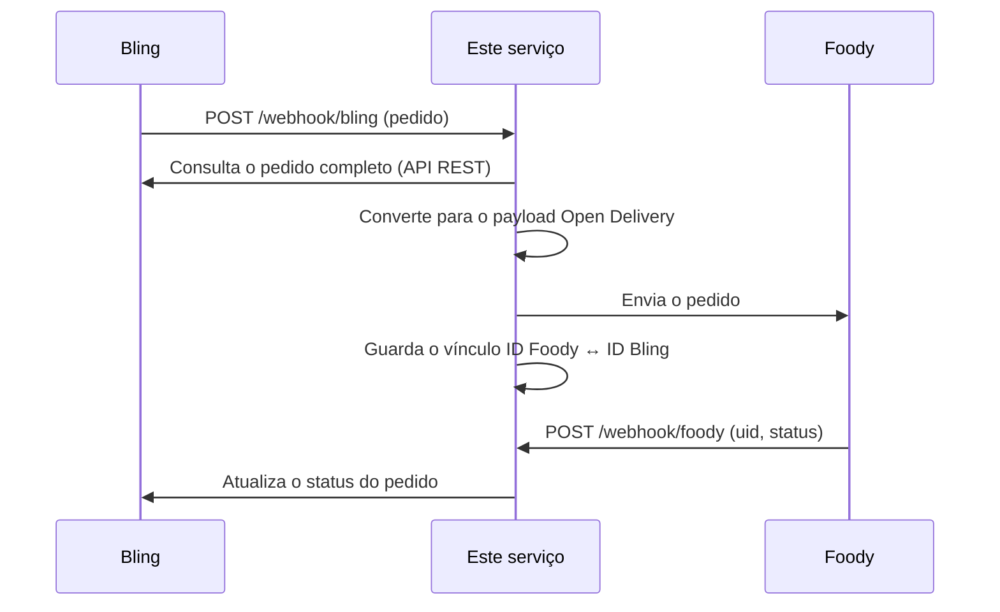

# Integração Bling + Foody

Serviço back-end em Node.js que integra o ERP **Bling** com a plataforma de entregas **Foody** (padrão Open Delivery). Quando um pedido chega do Bling por webhook, o serviço consulta os detalhes na API do Bling, converte para o formato Open Delivery e envia para a Foody. Quando a Foody avisa uma mudança de status, o serviço atualiza o pedido no Bling.

## Como funciona



## Endpoints

| Método | Rota | Função |
|---|---|---|
| GET | `/health` | Verificação de saúde do serviço |
| POST | `/webhook/bling` | Recebe o webhook de pedido do Bling |
| POST | `/webhook/foody` | Recebe a mudança de status enviada pela Foody |
| GET | `/oauth/callback` | Callback do OAuth2 do Bling (troca o código de autorização por tokens) |

## Decisões de projeto

- **Validação na entrada:** os dois webhooks rejeitam com 400 corpos incompletos, e o webhook da Foody responde 404 quando o pedido não está no mapeamento.
- **Mapeamento Foody ↔ Bling:** o vínculo entre o ID do pedido na Foody e o ID do pedido no Bling fica em um arquivo JSON local (`foody_bling_map.json`), carregado na inicialização.
- **Geocodificação:** os endereços de entrega são convertidos em coordenadas com o OpenStreetMap (Nominatim).
- **Logs estruturados:** uso do Pino nos módulos, com tratamento de erros centralizado em um middleware.
- **Credenciais fora do código:** chaves e tokens ficam em variáveis de ambiente e arquivos ignorados pelo Git.

## Stack

Node.js · Express · Axios · Pino · dotenv · OAuth2 · OpenStreetMap (Nominatim)

## Como executar

Requisitos: Node.js e credenciais de API do Bling e da Foody.

```bash
git clone https://github.com/svalessandro/webhooks.git
cd webhooks
cp .env.example .env   # preencha as variáveis abaixo
npm install
npm start
```

O servidor sobe na porta `8080` (ou na definida em `PORT`). Para conferir: `GET /health`.

### Variáveis de ambiente

| Variável | Descrição |
|---|---|
| `BLING_CLIENT_ID` / `BLING_CLIENT_SECRET` | Credenciais do aplicativo no Bling |
| `BLING_REFRESH_TOKEN` | Token de renovação obtido no fluxo OAuth2 |
| `BLING_TOKEN_URL` | URL de emissão de tokens do Bling |
| `FOODY_CLIENT_ID` / `FOODY_CLIENT_SECRET` | Credenciais da Foody |
| `FOODY_TOKEN_URL` | URL de autenticação da Foody |
| `FOODY_OPEN_DELIVERY_URL` | URL da API Open Delivery da Foody |
| `PORT` | Porta do servidor (opcional, padrão 8080) |

## Estrutura

```
src/
├── app.js            # servidor Express e rotas
├── logger.js         # configuração do Pino
├── middlewares/      # tratamento de erros
├── routes/           # webhooks do Bling e da Foody
├── services/         # APIs do Bling e da Foody, autenticação e mapeamento de IDs
└── utils/            # payload Open Delivery e geocodificação
```

## Próximos passos

- Testes automatizados (conversores de payload e rotas).
- Trocar o arquivo JSON do mapeamento por um banco de dados.
- Validar a assinatura dos webhooks recebidos.

## Autor

Alessandro Aparecido da Silva · Bauru/SP · [LinkedIn](https://www.linkedin.com/in/alessandroasv/) · [GitHub](https://github.com/svalessandro)
